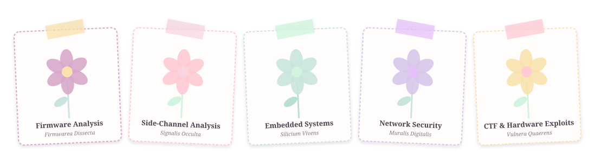

<div align="center">


<br>

### 🌺 *Tender of the garden: Embedded & Low-level systems engineer, with thorns on the Security side* 🛡️

</div>

<br>


## 🪴 About the garden

I'm a final-year **EXTC** engineer in Mumbai who works where **silicon, firmware and the operating system meet**. I build firmware, and I take other people's firmware apart. Most of my work happens at the lowest layers: finding debug interfaces on a bare PCB, pulling firmware out over UART, SWD or straight off the flash chip, reversing it in Ghidra, and working out what the code *actually* does on the metal.

Building teaches me how systems are meant to behave. Breaking them shows me how they really behave. After that, I write it all down so someone else can follow the same path. Half engineer, half storyteller.

```
🍀 Current saplings

🔧 building      CyberEdge-001 · ESP32-S3 firmware on FreeRTOS: drivers, state machine, safety guardrail layer
🐞 disclosing    2 vulnerabilities in coordinated disclosure (see below 🌱)
🌿 contributing  upstream open source · both as a hacker and as a dev
🪶 writing       research work on iotsec.in
🌸 cultivating   curiosity at the hardware–software boundary
```

<br>


## 🐞 Bugs in my garden

*Vulnerabilities I've found and reported through coordinated disclosure. The details stay underground until the vendors say they can bloom.*

| | Where | Status |
|---|---|---|
| 🌱 | **An RTOS** | Reported to the Project's security team · coordinated disclosure in progress · **goes public 25 Oct 2026** |
| 🌱 | **A global consumer electronics brand** | Consumer IoT device vulnerability, reported through the vendor's bug bounty program · in vendor triage |

> 🔒 Until then, no hints and no teasers. That's how disclosure works. Some of my other hardware security work (internship research and contributions) is also under confidentiality. If you'd like to talk about it in general terms, please reach out 🌸

<br>


## 🧷 Projects on the shelf

> 🌿 **[UART Recon](https://github.com/sanisapatrikar/UART-Recon)**
> I start from bare copper pads on a router PCB, find the pinout with a JTAGulator, and end up with a live root shell over UART. The repo covers the whole path: interface discovery, the console session and firmware exploration.

> 🪴 **[SWD Recon](https://github.com/sanisapatrikar/SWD-Recon)**
> SWD reconnaissance on two targets. The first was a GNSS module that refused to talk (DAP failures and all). The second was a Cube Orange+ flight controller (STM32H7), where I extracted the firmware over SWD and ran into a dual-bank flash surprise along the way.

> 🌾 **[CyberEdge-001](https://github.com/sanisapatrikar/CyberEdge-001)** · *growing, prototype due Nov 2026*
> An ESP32-S3 security training toolkit with modular Wi-Fi, BLE (nRF) and RFID add-ons. Its guardrails are built in so it can't easily be turned into a real attack device. I own the firmware and the security layer: FreeRTOS, a non-blocking state machine, MAC/UID ownership allowlists checked before any module runs, per-module timeouts and an on-device audit log.

> 🌵 **[Drone Mirage](https://github.com/1Horizon002/DRONE_MIRAGE-)** · *🏆 won Tech-a-thon 4.0*
> A two-node drone threat detection system. An airborne Raspberry Pi runs a custom YOLOv8 model to spot drones, and a ground-station Pi scores each one from benign to malicious through a threat engine.

> 🌼 **Upstream: [Zed](https://github.com/zed-industries/zed)**
> A documentation preprocessor fix in the Rust-based code editor. The story is in the library below.

*(and a few more growing quietly in the private greenhouse 🌱)*

<br>


## 📚 The garden library

*A library filled entirely with my works. Straight from the bench, for people coming in after me to follow thru, published on [iotsec.in](https://iotsec.in). They're technically precise, a little poetic, and honest about what didn't work.*

| | Pressing | What grew there |
|---|---|---|
| 🌷 | **[Whispers on the Wire: From Copper Pads to a Live UART Root Shell](https://iotsec.in/t/whispers-on-the-wire-from-copper-pads-to-a-live-uart-root-shell/87)** | Pinout hunting with a JTAGulator → a live root shell over UART |
| 🪻 | **[SWD Wasn't Talking, So I Changed the Target](https://iotsec.in/t/swd-wasnt-talking-so-i-changed-the-target-swd-reconnaissance-dap-failures-and-a-dual-bank-plot-twist/88)** | SWD reconnaissance, DAP failures, and a dual-bank plot twist |
| 🌹 | **[I Found a MITM Vulnerability in a Camera's TLS Handshake. I Was Wrong.](https://iotsec.in/t/i-found-a-mitm-vulnerability-in-a-cameras-tls-handshake-i-was-wrong-a-static-reversal-of-an-mbedtls-config-struct/106)** | A static reversal of an mbedTLS config struct, and what a disproved hypothesis teaches you |
| 🌻 | **[Swapping My Hacker Hat for a Dev One, for a Day](https://iotsec.in/t/swapping-my-hacker-hat-for-a-dev-one-for-a-day/107)** | Security research vs. shipping code: inspired by my work across both fields |

> 🪶 Outside the terminal, I write and do voice acting. To me, being able to explain why a side-channel attack matters to someone who has never held a chip is a security skill too.

<br>


## 🧵 The technical thread

<div align="center">

</div>

<br>

**Silicon & firmware**
<br>
    

**Interfaces I speak**
<br>
   

**Languages**
<br>
    

**Analysis**
<br>
    

**The workbench** *(hardware rig)*
<br>
       

<br>


## 🎀 Pressed flowers (milestones)

| | |
|---|---|
| 🔬 | **Embedded Security Research Intern**, CoE CNDS (VJTI): firmware extraction over UART & SWD, black-box IoT testing, side-channel experiments |
| 🏆 | **2× National Hackathon Winner**: Tech-a-thon 4.0 (Drone Mirage) · Hackquinox 2.0 (SafeLabs) |
| 🚩 | **CTFs**: placed at RedFox CTF (international) and RAIT-CTF (national) · won IEEE-CTF VESIT |
| 📜 | **CompTIA Security+** certified (2026) |
| 🎓 | **EXTC, VESIT Mumbai**: CGPA 9.48 · Class of 2027 |
| 🦔 | **Founding member & Senior Technical Head**, Cyber Tinkerers' Club, building a hardware/security community from zero |

<br>

<div align="center">

Let's talk 🌷

<a href="https://linkedin.com/in/sanisa-patrikar"></a> <a href="https://iotsec.in"></a> <a href="https://beyondthespeakingmind.wordpress.com"></a> <a href="mailto:sanisa.patrikar@gmail.com"></a>

<br><br>


</div>
